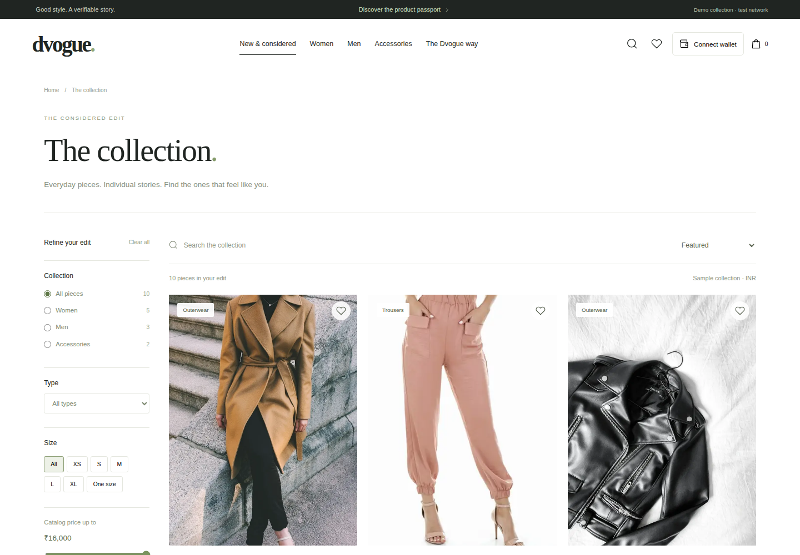
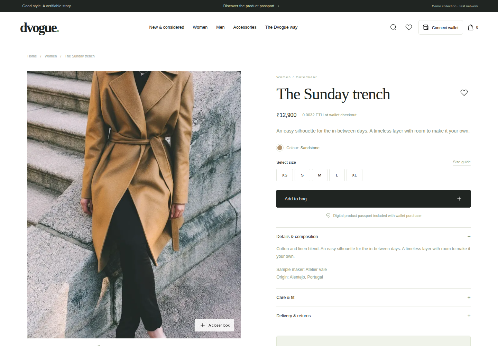
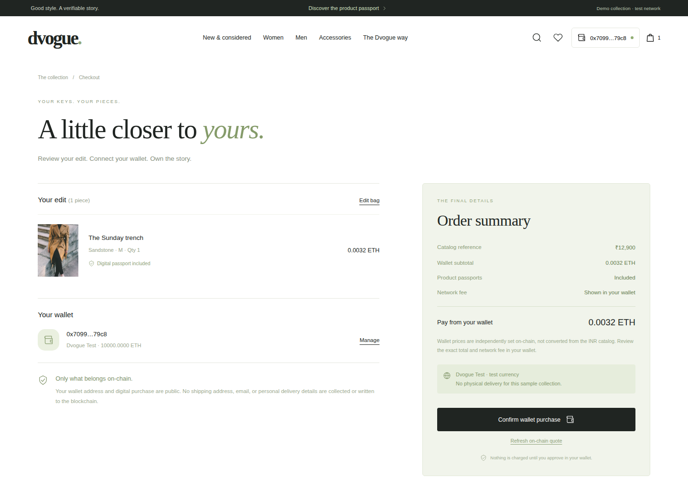
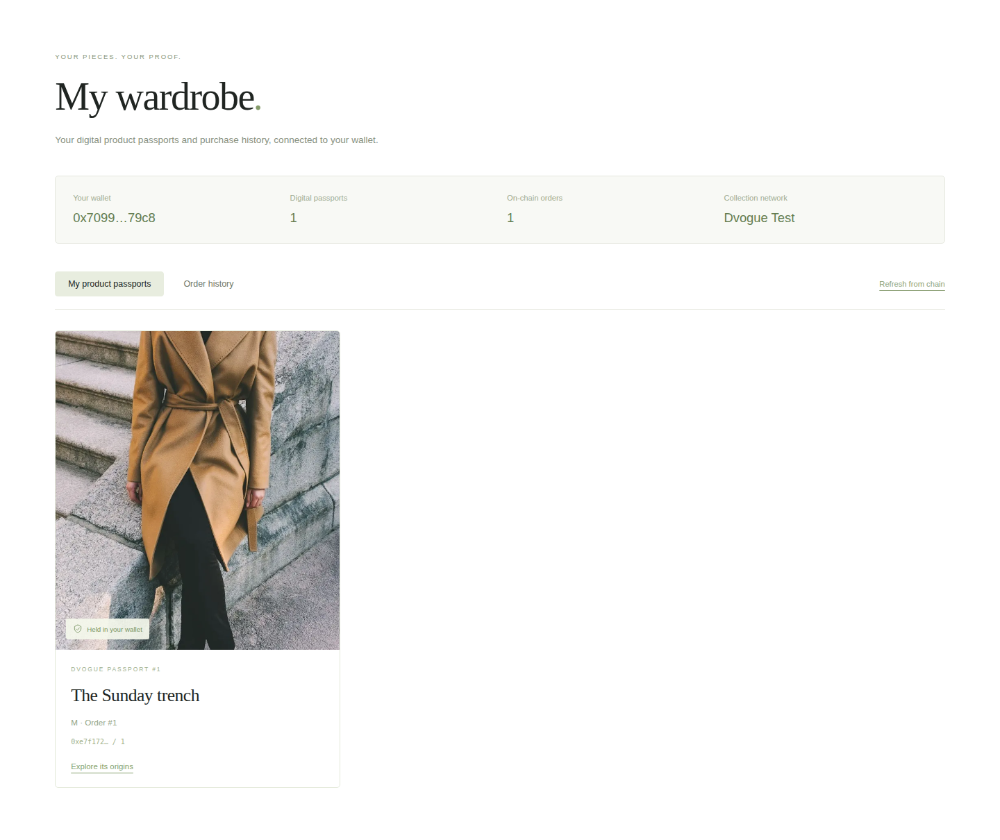
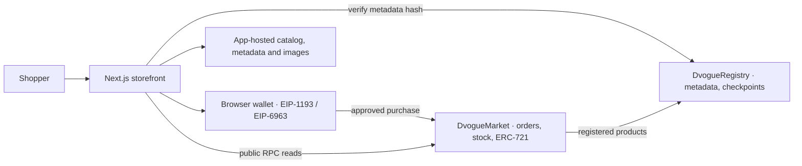

# Dvogue

### Fashion commerce with verifiable provenance and wallet-owned product passports.

[](https://github.com/MadhavVN011/Dvogue/actions/workflows/ci.yml)

**Next.js · React · Solidity · ethers.js · OpenZeppelin · Anvil · Playwright**

Dvogue connects a fashion storefront to two Solidity contracts. Buyers can explore a collection, verify registered product details, pay from an Ethereum-compatible wallet, and receive a transferable ERC-721 product passport for each purchased unit.

[Live demo](https://dvogue.vercel.app) · [Watch the walkthrough](docs/demo/dvogue-walkthrough.mp4) · [Architecture](docs/ARCHITECTURE.md) · [Run locally](#run-locally) · [Contract source](contracts/) · [Deployment guide](docs/DEPLOYMENT.md)


> **Project status:** the [public storefront is live on Vercel](https://dvogue.vercel.app) and connected to verified contracts on the **Sepolia testnet**. Wallet checkout and product passports work with test ETH from any EIP-1193 wallet such as MetaMask. The collection is illustrative, and physical sales and delivery are outside this demo's scope.

## The experience

- **Shop:** collection pages, search, category/type/size/price filters, sorting, product pages, size guides, wishlist, and a persistent shopping bag.
- **Verify:** compare canonical product metadata with an issuer's on-chain hash and inspect recorded provenance checkpoints.
- **Connect:** discover EIP-6963 browser wallets, handle account/network changes, and request a network switch before checkout.
- **Purchase:** fetch an on-chain quote, approve an exact-price transaction, and confirm the marketplace receipt before clearing purchased items.
- **Own:** view current ERC-721 passport ownership and original order history in My wardrobe. Token ownership follows transfers.
- **Recover:** preserve the bag after rejected requests and recover a submitted transaction after a page reload.

| Collection and filters | Product details and sizing |
| --- | --- |
|  |  |

| Wallet checkout | On-chain wardrobe |
| --- | --- |
|  |  |

The [recorded walkthrough](docs/demo/dvogue-walkthrough.mp4) follows browsing → provenance check → bag → wallet connection → purchase → passport → order history. Recording uses a test EIP-1193 wallet adapter connected to a disposable Anvil chain: purchases are actual local-chain transactions, and no real wallet extension or funds are used. The [mobile preview](docs/images/mobile.png) and [confirmed receipt](docs/images/receipt.png) are also included.

## Architecture



Orders, inventory, and passport ownership live on-chain. The frontend and metadata remain app-hosted. Read the [architecture notes](docs/ARCHITECTURE.md) for the transaction sequence, trust boundaries, and design tradeoffs.

## Smart contracts

| Contract | Responsibility | Key behavior |
| --- | --- | --- |
| [DvogueRegistry](contracts/DvogueRegistry.sol) | Product metadata and provenance | Owner-only registration, duplicate protection, ordered checkpoints, metadata digest verification |
| [DvogueMarket](contracts/DvogueMarket.sol) | Native-currency checkout and product passports | Exact unit-price and payment checks, size-level stock, atomic purchases, order receipts, ERC-721 minting/transfers, owner withdrawals |

The market uses OpenZeppelin's `ERC721Enumerable`, `Ownable`, and `ReentrancyGuard`. Contract builds pin the compiler, optimizer settings, and Cancun EVM target. A complete Standard JSON compiler input is generated for reproducibility and explorer verification.

### Sepolia deployment

Both contracts are deployed and source-verified on Etherscan (Solidity 0.8.39, optimizer 200 runs, Cancun EVM):

| Contract | Sepolia address |
| --- | --- |
| DvogueRegistry | [`0x7ff4Ebb70838B28cBDB3b6Bc61af172b6184Fd3C`](https://sepolia.etherscan.io/address/0x7ff4Ebb70838B28cBDB3b6Bc61af172b6184Fd3C#code) |
| DvogueMarket | [`0x7cF00D8536c9Dac5155769e3431Ef28cC696d51b`](https://sepolia.etherscan.io/address/0x7cF00D8536c9Dac5155769e3431Ef28cC696d51b#code) |

The registry holds the ten sample products with three provenance checkpoints each, and the market lists all 38 size variants. Chain ID **11155111**; prices are in Sepolia test ETH.

## Run locally

Use Node.js 24 (`.nvmrc`). No wallet or chain is required to browse.

```sh
npm ci
npm run dev
```

Open **http://localhost:3000**.

To enable blockchain checkout, start the local chain in a separate terminal:

```sh
npm run contracts:node
```

Then deploy the collection:

```sh
npm run contracts:deploy
```

Reload the storefront and connect a development wallet. Local network: **chain ID 31337**, **RPC http://127.0.0.1:8545**, **test ETH**. Fund its public address with:

```sh
npm run wallet:fund -- <your-development-wallet-address>
```

Local accounts and currency are for development only. The app never asks for wallet private keys or recovery phrases. See the [development guide](docs/DEVELOPMENT.md) for the full setup, test-chain resets, troubleshooting, and media capture.

## Verification

```sh
npm run check         # lint, domain/contract checks, production build
npm run test:browser  # desktop + mobile against an isolated seeded chain
npm audit
```

[GitHub Actions](.github/workflows/ci.yml) runs these checks on pushes and pull requests to `main`, installs Chromium, and uploads the browser report and failure traces. Neither contract tests nor browser tests need deployment secrets or real funds.

| Layer | Coverage |
| --- | --- |
| Domain | Catalog queries, price sorting, bag sanitization, corrupt storage input |
| Contracts and client reads | Authorization, invalid registrations/carts, ordered checkpoints, metadata mismatches, exact payments, price changes, inventory, ERC-721 ownership/transfers, URI snapshots, withdrawals, receiver reentrancy, atomic mint rollback, wardrobe queries |
| Browser | Seven scenarios on desktop and mobile: navigation/search/filters, sizing/provenance/wishlist/bag, missing and rejected wallets, network switching and purchases, receipt recovery, blocked storage |

The browser suite uses a test wallet adapter. A real MetaMask purchase on the hosted Sepolia deployment has also been completed and confirmed on-chain (order #1, passport #1).

## Design decisions

- **Exact-price checkout:** the contract compares reviewed unit prices with current listings, avoiding silent price changes between quote and purchase.
- **Atomic stock and minting:** stock, order records, and passports succeed together; a rejected ERC-721 receiver rolls back the purchase.
- **Receipt-based confirmation:** a successful UI state requires a mined transaction and the expected marketplace event for the buyer.
- **Ownership-based wardrobe:** current token holders see passports, while original buyers retain their order history.
- **Explicit trust boundaries:** metadata matching verifies an issuer's registered data; it does not certify physical authenticity or sourcing claims.

[Read the technical walkthrough and interview notes](docs/ARCHITECTURE.md#technical-walkthrough).

## Scope and next steps

This is a single-merchant, hybrid Web3 prototype. The owner manages listings, attestations, and withdrawals. Catalog INR prices and contract ETH prices are independent, with no live conversion. Token URIs are captured at issuance, but app-hosted metadata content is mutable. No escrow, refunds, shipping, multi-seller administration, or independent security audit is provided.

The [deployment guide](docs/DEPLOYMENT.md) covers public hosting, a funded testnet development wallet, contract verification, and real-wallet validation. The storefront is hosted at [dvogue.vercel.app](https://dvogue.vercel.app), with contracts on Sepolia listed under [Sepolia deployment](#sepolia-deployment).

## Project layout

```text
app/                 Next.js pages, styles and public metadata/configuration APIs
components/          Shopping UI, wallet discovery, bag and wishlist persistence
contracts/           Provenance registry and ERC-721 marketplace
lib/                 Catalog, validation, blockchain queries and checkout
scripts/             Compiler, deploy/seed, wallet funding and demo capture
tests/              Domain, contract and browser checks, test wallet adapter
docs/               Screenshots, walkthrough, architecture and setup guides
.github/workflows/   Continuous integration
```

Photography is illustrative; sources are listed in [ATTRIBUTION.txt](public/images/ATTRIBUTION.txt). The original NEXUS presentation is retained as project context.
