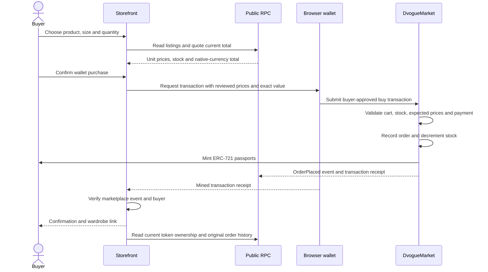

# Architecture and engineering notes

Dvogue is a single-merchant Web3 fashion commerce prototype. It combines a Next.js storefront, a product-provenance registry, and a native-currency marketplace that issues ERC-721 product passports.

## Components and data ownership

| Component | Stores or handles | Trust boundary |
| --- | --- | --- |
| Next.js / React | Catalog display, search/filters, shopping flow, metadata APIs | App hosting and catalog content are centrally managed |
| Browser storage | Bag, wishlist, pending transaction reference | Convenience state only; it cannot change contract prices, stock or ownership |
| Browser wallet | Account access and explicit transaction approvals | Keys remain under wallet control; connection is not payment authorization |
| Public RPC provider | Contract reads and submitted transaction status | The app checks the configured chain, deployed market code and linked registry |
| `DvogueRegistry` | Metadata hashes/URIs and ordered issuer checkpoints | Only the issuer owner writes records; attestations are not independent certifications |
| `DvogueMarket` | Listings, stock, orders, order lines, ERC-721 ownership and passport URIs | Owner controls listing updates and withdrawals; buyers control their own tokens |
| App metadata endpoints | Product JSON, NFT metadata and images | Content is app-hosted and may change; token URI snapshots do not make the URI's content immutable |

`/api/network` exposes only public configuration. Local deployments read an ignored `.dvogue/deployment.json`; environment values support hosted deployment. A deployment private key is used by the local deployment script, never by the storefront or hosted API.

## Purchase sequence

ERC-721 receiver callbacks execute during minting. A callback can reject a token; in that case the entire transaction reverts, including inventory and order writes. Purchases, listing updates, and withdrawals use reentrancy protection.

## Product identity and metadata

The catalog uses human-readable SKUs. `keccak256(sku)` identifies a registered product, and `keccak256(sku + ':' + size)` identifies a sale variant. Products and size variants have separate identifiers so a single provenance record can describe several inventory listings.

`productMetadata()` produces a canonical object containing version, SKU, name, material, origin and maker. Verification hashes the same JSON serialization used during registration and compares it with the registry record. Pricing and size inventory belong to marketplace listings rather than the provenance digest.

The registry starts at stage 0 when a product is registered. Subsequent checkpoints must advance sequentially through material sourcing, manufacture, quality checking and shipping. Local seeding records stages 1–3 as sample issuer attestations; shipping remains unrecorded.

## Decisions and tradeoffs

### Native-currency payments

Native ETH payments keep the purchase flow to one wallet transaction. There is no ERC-20 allowance step or exchange-rate oracle. INR catalog prices and fixed contract prices are separate demo values, which checkout labels explicitly.

The reviewed unit-price array is included in `buy`. If an owner changes a listing's price after the quote, the transaction reverts instead of accepting a changed price. The contract also requires the exact total payment, avoiding untracked overpayments or refund calculations.

### Bounded, atomic purchases

A cart accepts at most 20 units, at most 10 units per size variant, and no duplicate variants. Limits bound the minting and inventory loops. Stock and order lines are committed before external receiver callbacks, and a receiver failure reverts all changes.

The public `quote` is a current-state read, not a stock reservation. A second buyer can consume inventory before the first buyer's transaction mines. The purchase validates stock again on-chain.

### Enumerable passports

`ERC721Enumerable` allows the wardrobe to read a wallet's current tokens without an external indexing service. It adds mint/transfer storage costs, which are acceptable for this bounded demo. The UI paginates reads in groups of twelve. A larger service could use indexed events to reduce read costs and improve discovery.

Order history and current ownership are intentionally different. A token transfer changes the current holder's wardrobe without rewriting the original buyer's receipt. Physical product ownership or delivery is not enforced by token transfer.

### Receipt verification and recovery

The UI checks the mined receipt, the emitting marketplace address, and the `OrderPlaced` buyer before showing confirmation. Rejected wallet requests leave bag contents intact. After submission, a session-stored transaction reference lets checkout inspect the existing receipt after reload. A submitted-but-unverified transaction is held for status checking instead of immediately offering another payment.

This is browser-session recovery, not an indexer or a full transaction-management service. Clearing browser storage, replacing a transaction externally, RPC outages, or resetting Anvil may require checking wallet history manually. The app does not implement a production finality/reorganization policy.

### Owner-managed issuer and merchant

One owner manages provenance and listing updates. Funds remain in the market until that owner withdraws them. There are no upgrade proxies, seller registrations, marketplace commissions, escrow, dispute resolution, or refunds. This scope keeps the demonstrated trust model visible and the contracts focused.

## Verification strategy

- Domain tests validate catalog behavior and persisted bag input.
- Contract tests deploy both contracts on a fresh Anvil instance. They cover authorization, input bounds, payment and price checks, stock accounting, transfers, URI snapshots, withdrawals, reentrant receivers, and rollback after rejected minting.
- Client checks exercise actual RPC quotes, purchases and wardrobe reads.
- Browser tests cover seven user scenarios on both desktop and mobile. The injected test wallet forwards requests to a separate disposable blockchain; it does not automate an installed wallet extension.
- CI installs locked dependencies and runs lint, domain/contract checks, a production build, browser checks and dependency auditing. Reports and failure traces are uploaded as artifacts.

The walkthrough recording uses the same isolated-chain test adapter, with real local transactions. It demonstrates the application flow rather than MetaMask extension automation or public-network deployment.

## Technical walkthrough

A short demonstration can follow this route:

1. Show the collection and filter products by category, size or price.
2. Open a product and compare the registered metadata hash with catalog details.
3. Select a size, add it to the bag, and inspect the on-chain quote.
4. Connect a development wallet, approve the purchase, and inspect the confirmed receipt.
5. Open My wardrobe to show the minted passport and original order history.
6. Explain a rejected payment, changed-price protection, and the distinction between issuer claims and independently verified provenance.

For interviews, be prepared to trace `quoteBag` → `purchase` → `DvogueMarket.buy` → `verifyPurchaseReceipt` → `readWardrobe`, and explain why client-side validation does not replace contract checks.

A concise project description for a resume:

> Built a Next.js and Solidity fashion commerce prototype with wallet checkout, on-chain product provenance, transferable ERC-721 passports, transaction recovery, and automated contract and desktop/mobile browser tests.

Only describe public deployment, third-party audits, production usage, or performance metrics if those have actually been completed and measured.

## References

- [OpenZeppelin ERC-721](https://docs.openzeppelin.com/contracts/5.x/api/token/erc721)
- [OpenZeppelin utilities and ReentrancyGuard](https://docs.openzeppelin.com/contracts/5.x/api/utils)
- [EIP-6963 wallet discovery](https://eips.ethereum.org/EIPS/eip-6963)
- [EIP-1193 provider interface](https://eips.ethereum.org/EIPS/eip-1193)
- [Solidity Standard JSON compiler interface](https://docs.soliditylang.org/en/latest/using-the-compiler.html#compiler-input-and-output-json-description)
